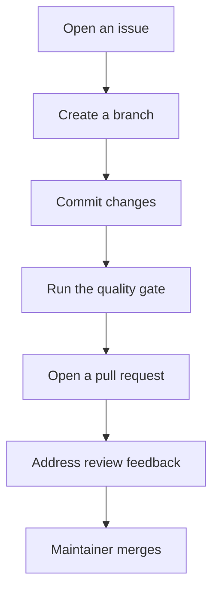

# Contributing to ffxiv-config

Thanks for your interest in improving **ffxiv-config**! This guide covers development setup,
conventions, the quality gate, and how to submit changes.

> By participating you agree to our [Code of Conduct](./CODE_OF_CONDUCT.md). For security issues,
> follow [SECURITY.md](./SECURITY.md) — **do not** open a public issue.

## Ways to contribute

- 🐛 **Report bugs** via the repository's issue tracker (bug form).
- ✨ **Propose features** via the repository's issue tracker (feature form).

- 📝 **Improve documentation**.

- 🔧 **Submit code** via pull request.
- 👀 **Review pull requests** from other contributors.

Open an issue or comment on an existing one before starting significant work, so the approach can be
discussed first.

## Development setup

Ruby (>=3.1) and Bundler.

```bash
npm install
bundle exec jekyll serve
```

Runs on http://localhost:4000.

## Quality gate

Everything below must pass with **zero errors and zero warnings** before a pull request is merged:

```bash
bundle exec jekyll build
```

## Conventions

- {{CONVENTIONS}}
- Keep changes minimal and focused; match the surrounding style.
- Update `CHANGELOG.md` when behavior changes.

## Commit style

We use [Conventional Commits](https://www.conventionalcommits.org/) with concise, imperative
subjects:

```
<type>(<scope>): <short summary in imperative mood>
```

Common types: `feat`, `fix`, `docs`, `test`, `refactor`, `perf`, `chore`, `security`, `build`.

## Pull request process

The contribution path from idea to merge:



1. **Open an issue first** for non-trivial changes.
2. **Create a branch** from the default branch.
3. **Make focused commits** following the commit style above.
4. **Run the quality gate** (zero errors, zero warnings).
5. **Update docs/changelog** if behavior changed.
6. **Open a PR** and complete the template.
7. **Respond to review feedback** and keep the branch up to date.

Do not push directly to the default branch. Releases are cut by maintainers (see
[GOVERNANCE.md](./GOVERNANCE.md)).

## Getting help

See [SUPPORT.md](./SUPPORT.md).
