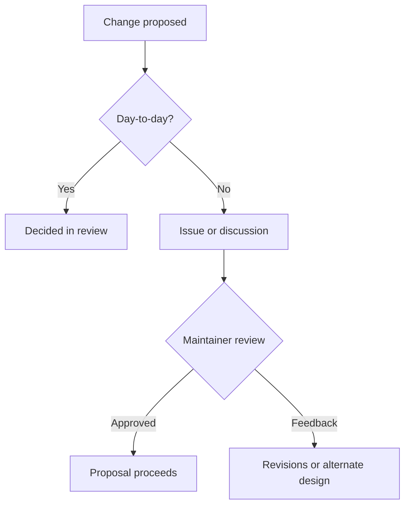

# Governance

This document describes how **ffxiv-config** is governed.

## Roles

| Role | Responsibilities |
| --- | --- |
| **Maintainer** | Sets project direction, reviews and merges pull requests, publishes releases and tags, triages issues, and upholds project standards. |
| **Contributors** | Submit issues, discussions, documentation, and pull requests under the project's license and contribution guidelines. |
| **Users** | Use the software, provide feedback, and report bugs or feature requests through the project's issue forms. |

## Decision making

- Day-to-day changes, bug fixes, and feature proposals are discussed and reviewed via issues and pull requests.
- Significant design or architectural decisions are discussed in GitHub issues or discussions to gather feedback.
- The project maintainer sets the roadmap, guides architecture, reviews contributions, and has final decision-making authority on scope and implementation.

How a proposal moves to a decision:

## Releases

- Releases follow [Semantic Versioning](https://semver.org/) (`vMAJOR.MINOR.PATCH`).
- Releases and git tags are published by the project maintainer.
- Every release includes curated release notes; changelog entries follow
  [Keep a Changelog](https://keepachangelog.com/).

## Contributions

All contributions are made under the project's license and must follow
[CONTRIBUTING.md](./CONTRIBUTING.md) and the [Code of Conduct](./CODE_OF_CONDUCT.md).

## Changes to this document

Governance changes are proposed via pull request and require maintainer approval.
