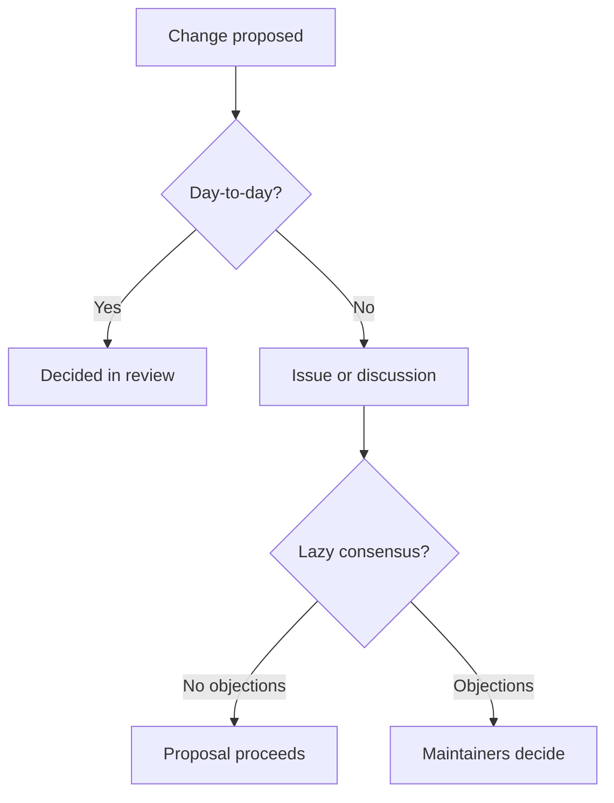

# Governance

This document describes how **ffxiv-config** is governed.

## Roles

| Role | Responsibilities |
| --- | --- |
| **Maintainers** | Set direction, review and merge pull requests, manage releases and tags, triage issues, and uphold the Code of Conduct. |
| **Contributors** | Submit issues, discussions, documentation, and pull requests under the project's license and contribution guidelines. |
| **Users** | Use the software and report bugs/feature requests through the project's issue forms. |

## Decision making

- Day-to-day changes are decided in pull requests through review and discussion.
- Significant design or scope decisions are opened as an issue or discussion first to gather input.
- Maintainers aim for **lazy consensus**: a proposal proceeds if no maintainer objects within a
  reasonable review window. When consensus is not reachable, maintainers decide by simple majority.

How a proposal moves to a decision:

## Releases

- Releases follow [Semantic Versioning](https://semver.org/) (`vMAJOR.MINOR.PATCH`).
- **Only maintainers** create releases and push tags.
- Every release has human-written release notes; changelog entries follow
  [Keep a Changelog](https://keepachangelog.com/).

## Contributions

All contributions are made under the project's license and must follow
[CONTRIBUTING.md](./CONTRIBUTING.md) and the [Code of Conduct](./CODE_OF_CONDUCT.md).

## Changes to this document

Governance changes are proposed via pull request and require maintainer approval.
