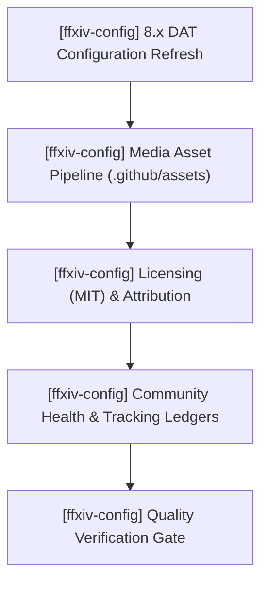

# ffxiv-config — Active Sprint Planning

> 🎯 **Living Source of Truth**: Active sprint roadmap, execution architecture, and completed sprint history for **ffxiv-config**.
> Pair with [`ROADMAP.md`](./ROADMAP.md) (direction), [`TODO.md`](./TODO.md) (task ledger), and [`BUGS.md`](./BUGS.md) (known issues).

> [!IMPORTANT]
> AI agents are strictly required to update this page and related tracking ledgers **before** executing new feature work or bug fixes and keep them synchronized.

---

## 📜 Tracking Rules

- **No Typo Duplication**: When recording user reports, clean and fix all typos to preserve professional quality.
- **Consistent Formatting**: Maintain consistent formatting and style throughout all documentation to ensure readability and professionalism.
- **Clear Sectioning**: Use clear and descriptive headers for each section to improve navigation and readability.
- **Active Items First**: The currently active milestone, sprint, task, or workstream must always be placed at the top of the content sections.
- **Active Sprints Only in Top Section**: `## 🎯 Active Sprints` must contain ONLY the currently active sprint(s). Once a sprint is completed, move it immediately to `## ✅ Completed Sprints` (newest first).
- **100% Active Direction Accuracy**: Continuously refine and synchronize sprint tasks with the current active direction of each project; immediately update or remove superseded tasks rather than leaving contradictory statements.
- **Explicit Project Tagging**: In multi-project or organization tracking ledgers, every sprint header, task, and execution deliverable MUST be explicitly prefixed with its current project name and repository path (e.g., `[ffxiv-config] (ffxiv-config)`).
- **Tracking Docs Stay True**: Update `ROADMAP.md`, `TODO.md`, `BUGS.md`, and `PLAN.md` first or in lockstep with code changes.

---

## 🎯 Active Sprints

### 🚀 Sprint 1: [ffxiv-config] (ffxiv-config) — 8.x Configuration Sync, Media Asset & Governance Alignment
- **Project Identifier:** `[ffxiv-config]`
- **Repository Path:** `ffxiv-config`
- **Target Objective:** Refresh character configuration `.DAT` files for FFXIV Dawntrail (8.x), bundle high-resolution in-game preview into `.github/assets/`, align licensing to MIT with upstream attribution, and establish self-contained community health and project-local tracking ledgers.

#### 📝 Execution Tasks

1. **[ffxiv-config] 8.x DAT Configuration Refresh**:
   - `[ffxiv-config]` Sync updated binary `.DAT` files (`ADDON.DAT`, `CONTROL0.DAT`, `GEARSET.DAT`, `HOTBAR.DAT`, `ITEMFDR.DAT`, `ITEMODR.DAT`, `KEYBIND.DAT`, `MACRO.DAT`, `UISAVE.DAT`).
   - `[ffxiv-config]` Verify file integrity and character folder installation structure.
2. **[ffxiv-config] Media Asset Pipeline**:
   - `[ffxiv-config]` Place high-resolution HUD & hotbar preview in `.github/assets/preview.jpg`.
   - `[ffxiv-config]` Wire raw GitHub image URL into minimal entry point `README.md`.
3. **[ffxiv-config] Licensing & Upstream Alignment**:
   - `[ffxiv-config]` Ensure project license is strictly MIT across `LICENSE`, `README.md`, and `CITATION.cff`.
   - `[ffxiv-config]` Maintain attribution to Fr4nsson's FFC.
4. **[ffxiv-config] Community Health & Local Tracking**:
   - `[ffxiv-config]` Populate `CHANGELOG.md` following Keep a Changelog standards.
   - `[ffxiv-config]` Maintain project-local tracking files (`ROADMAP.md`, `PLAN.md`, `TODO.md`, `BUGS.md`, `HANDOFF.md`).

---

## 🔮 Planned Sprints

### ⏳ Sprint 2: [ffxiv-config] (ffxiv-config) — Multi-Resolution Profiles & Helper Scripts
- **Project Identifier:** `[ffxiv-config]`
- **Repository Path:** `ffxiv-config`
- `[ffxiv-config]` Provide distinct resolution variant profiles (1080p, 1440p, 4K, ultrawide).
- `[ffxiv-config]` Develop optional automated character folder backup and restore helper utility.
- `[ffxiv-config]` Expand job-specific hotbar guides on centralized documentation hub.

---

## ✅ Completed Sprints

### 🏁 Sprint 0: [ffxiv-config] (ffxiv-config) — Centralized Documentation Decoupling
- Decoupled legacy embedded Jekyll site from repo to centralized `docs` repository.
- Converted `README.md` to a clean, minimal entry point.
- Established basic repository structure.
