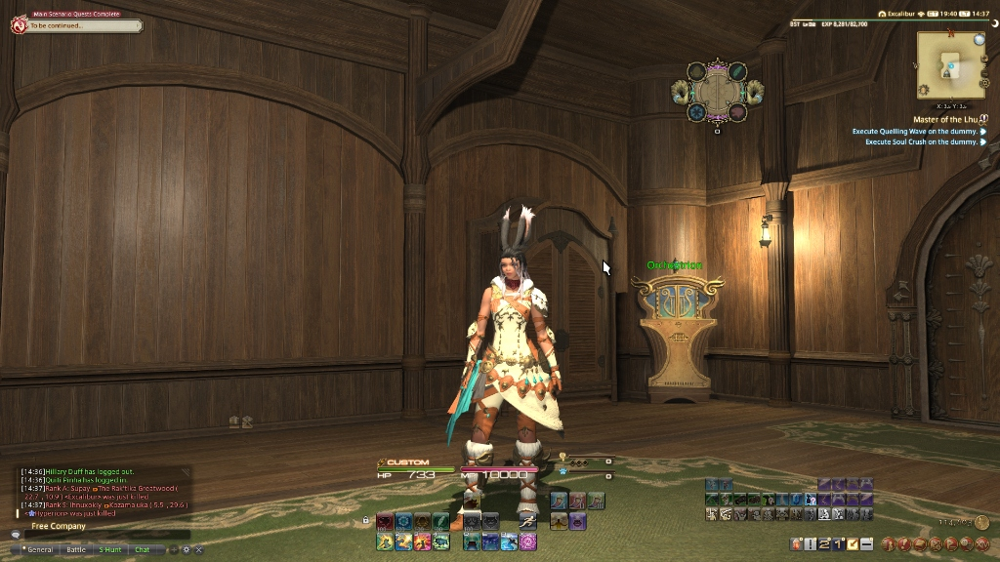

# FFXIV Config

  
  
  

A custom, information-dense HUD and hotbar setup for **Final Fantasy XIV**, built on top of [Fr4nsson's FFXIV Config (FFC)](https://github.com/Fr4nsson/FFC) with up-to-date support for 8.x jobs.

---

## Primary Gateways

All comprehensive configuration guides, job breakdowns, and installation manuals are centrally hosted:

- **Documentation**: [docs.helix-origin.club/ffxiv-config](https://docs.helix-origin.club/ffxiv-config/) - Installation, HUD layouts, hotbars, and macros.
- **Organization Portal**: [www.helix-origin.club](https://www.helix-origin.club/) - HELIX Origin organization hub.

---

## Quick Start

1. **Back up** your existing character folder (`Documents\My Games\FINAL FANTASY XIV - A Realm Reborn\FFXIV_CHR<id>\`).
2. **Copy** the files from [`src`](src) into your target `FFXIV_CHR<id>\` folder.
3. **Launch** the game and verify your new HUD and hotbars.

---

## Community & Contributing

- [Contributing Guide](CONTRIBUTING.md) - development setup, coding conventions, and the PR process.
- [Code of Conduct](CODE_OF_CONDUCT.md) - community expectations.
- [Support](SUPPORT.md) - where to get help.
- [Governance](GOVERNANCE.md) - roles, decision making, and release policy.
- [Security Policy](SECURITY.md) - private vulnerability reporting.

See also [Privacy](PRIVACY.md), [Terms](TOS.md), [Changelog](CHANGELOG.md), and [Citation](CITATION.cff).

---

## License

[MIT](LICENSE) - Copyright (c) 2026, HELIX Origin. Base layout adapted from Fr4nsson's FFC.
