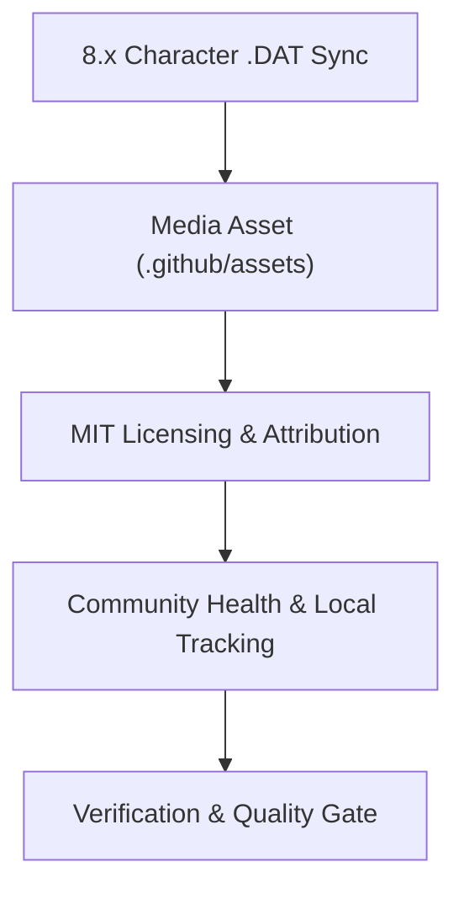

# ffxiv-config — Roadmap & Milestones

> 🗺️ **Living Source of Truth**: Product direction, positioning principles, and milestone delivery history for **ffxiv-config**.
> Pair with [`PLAN.md`](./PLAN.md) (sprint execution), [`TODO.md`](./TODO.md) (task ledger), and [`BUGS.md`](./BUGS.md) (issues and quirks).

> [!IMPORTANT]
> AI agents are strictly required to update this page and related tracking ledgers **before** executing new feature work or bug fixes and keep them synchronized.

---

## 📜 Tracking Rules

- **100% Active Direction Accuracy (Root & Archives)**: `ROADMAP.md`, `PLAN.md`, `TODO.md`, `BUGS.md`, and `.github/*-ARCHIVE.md` must reflect the 100% current, active direction of all projects with zero contradictions. Immediately replace or remove superseded statements across both root and archive files.
- **Zero External Mentions**: Never directly mention by name any external, third-party, or deleted projects or repositories outside of legitimate software upstream attributions.
- **No Typo Duplication**: When recording user reports or directives, clean and fix all typos to preserve professional quality.
- **Explicit Project Tagging**: Every milestone, sprint, task, or deliverable header and row MUST explicitly include its current project name and repository path (e.g., `[ffxiv-config] (ffxiv-config)`).
- **Bare Minimal Root & Normalized Archive**: Keep `ROADMAP.md` focused on active and upcoming milestones; archive delivered milestone narratives into `.github/ROADMAP-ARCHIVE.md`.

---

## 🔭 Vision & Positioning Principles

1. **Core Value Proposition**: An information-dense, modern HUD, hotbar, and macro layout for Final Fantasy XIV combat and crafting jobs, optimized for clarity, reaction speed, and Dawntrail (8.x) job mechanics.
2. **Design Principles**:
   - **Centralized Focus**: Core job gauges, cooldowns, and status bars clustered ergonomically around character center without obstructing boss arenas.
   - **Modular Hotbars**: Combat abilities grouped logically across cross-hotbars and standard hotbars with consistent keybind patterns across all roles.
   - **Upstream Respect & Attribution**: Built on the foundation of Fr4nsson's FFC with explicit attribution, licensed under MIT to remain completely accessible.
3. **Non-Goals & Boundaries**:
   - **No Game File Injection**: Only ships standard Square Enix character configuration `.DAT` files; no DLL mods, third-party hooks, or injectables.
   - **No Embedded Documentation**: All manuals and tutorials live centrally on the organization documentation hub (`docs.helix-origin.club/ffxiv-config/`).

---

## 🗺️ Milestone Overview

| # | Milestone | Scope / Repository | Status | Release / Target | Focus |
|---|---|---|---|---|---|
| **M1** | [ffxiv-config] Initial Scaffolding & Docs Decoupling | `ffxiv-config` | ✅ Shipped | v0.1.0 | Decouple Jekyll docs, minimal entry point README |
| **M2** | [ffxiv-config] Dawntrail 8.x Config & Governance | `ffxiv-config` | 🚀 Active | v0.2.0 | 8.x DAT sync, MIT license, in-game preview, community suite |
| **M3** | [ffxiv-config] Multi-Resolution Profiles & Helpers | `ffxiv-config` | ⏳ Planned | v0.3.0 | 4K/Ultrawide presets, automated backup/restore scripts |

---

## 🚀 Active Milestones

### [ffxiv-config] (ffxiv-config) — Milestone M2: Dawntrail 8.x Config & Governance

#### Detailed Deliverables

- 🎯 **[ffxiv-config] Character Configuration Refresh**: Sync updated binary `.DAT` files for Dawntrail 8.x jobs.
- 🎯 **[ffxiv-config] High-Resolution Media Asset**: Store HUD/hotbar screenshot in `.github/assets/preview.jpg` and display in README.
- 🎯 **[ffxiv-config] MIT License & Upstream Attribution**: Harmonize license across files with attribution to Fr4nsson's FFC.
- 🎯 **[ffxiv-config] Full Community Health Suite**: Self-contained contributing guide, code of conduct, security, support, governance, and citation metadata.
