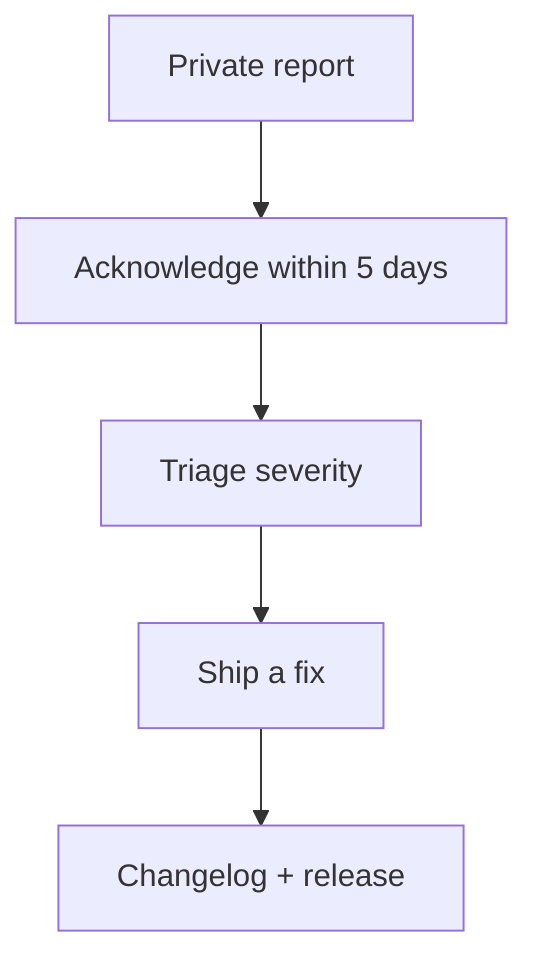

# Security Policy

We take the security of **ffxiv-config** seriously — for the application itself and for the
privacy of the data you keep on your own machine.

## 🛡️ Supported versions

| Version | Supported |
| --- | --- |
| v0.1.0 | ✅ Active |
| v0.0.9 | ⚠️ Upgrade recommended |
| older | ❌ No longer supported |

Only the latest release receives security fixes.

## 🚨 Reporting a vulnerability

**Do not open a public issue** for a security vulnerability.

Report privately using GitHub's **private vulnerability reporting**:

- Repository → **Security** → **Report a vulnerability**

Please include:

1. The affected version(s) and platform.
2. A clear description of the vulnerability.
3. Minimal steps to reproduce.
4. Impact assessment and — if you have one — a suggested fix.

The disclosure path every report follows:

We aim to acknowledge reports within **5 business days** and to ship a fix for confirmed issues in a
reasonable window depending on severity. Security fixes are noted in
[CHANGELOG.md](./CHANGELOG.md).

## 🎯 Scope

In scope (examples):

- Code execution, path traversal, or arbitrary file writes via the app, installer, or uninstaller.
- Injection or data corruption via the backend, local storage, or the WebView bridge.
- Untrusted-input handling (remote metadata, filenames, URLs) that breaks the app or leaks data.
- Insecure release pipeline (tampered binaries, malicious installers).

Out of scope (examples):

- Issues that fundamentally stem from a third-party service the app consumes.
- Denial-of-service against third-party services.
- Reports about the third-party service's own API or website.

## 🔐 Security design notes

- **Local-first**: no telemetry; user data lives only on the local machine.
- **Secrets**: API keys/tokens are stored locally and never committed; see `PRIVACY.md`.
- **No remote code paths**: rendering happens in a CSP-restricted WebView.
