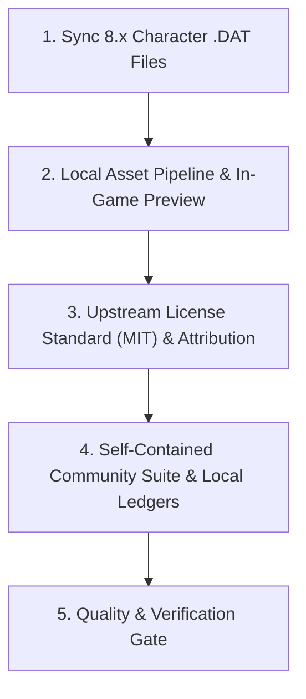

# ffxiv-config — Task Checklist & Workstream Tracking

> 📋 **Living Source of Truth**: Actionable task ledger for **ffxiv-config**.
> Statuses: ⬜ backlog · 🚧 in progress · ✅ done (tracked as `- [ ]` and `- [x]` checkboxes).
> High-level direction lives in [`ROADMAP.md`](./ROADMAP.md), active sprints in [`PLAN.md`](./PLAN.md), issues in [`BUGS.md`](./BUGS.md).

> [!IMPORTANT]
> AI agents are strictly required to update this page and related tracking ledgers **before** executing new feature work or bug fixes and keep them synchronized.

---

## 📜 Tracking Rules

- **No Typo Duplication**: When recording user reports, clean and fix all typos to preserve professional quality.
- **Consistent Formatting**: Maintain consistent formatting and style throughout all documentation to ensure readability and professionalism.
- **Active Items First**: The currently active milestone, sprint, task, or workstream must always be placed at the top of the content sections.
- **Improve & Categorize User Directives**: Rewrite user directives into clean, self-contained engineering requirements grouped by domain sub-headers. Never dump raw chronological chat quotes or leave contradictory superseded statements.
- **100% Active Direction Accuracy**: Whenever a requirement pivots or supersedes an earlier decision, replace the superseded directive in place across `ROADMAP.md`, `PLAN.md`, `TODO.md`, and `BUGS.md`.
- **Done Moves Down**: When a workstream is done, check it off and archive detailed checklists to `.github/TODO-ARCHIVE.md`, leaving a concise single-line summary under Completed Workstreams.
- **Tracking Docs Stay True**: Update `ROADMAP.md`, `TODO.md`, `BUGS.md`, and `PLAN.md` first or in lockstep with code changes.

---

## 🔥 Active Workstreams

### 🎯 [ffxiv-config] Workstream W.01: 8.x Configuration Sync, Media Asset & Governance Alignment
- **Project Identifier:** `[ffxiv-config]`
- **Repository Path:** `projects/ffxiv-config`
- **Target Component:** Character Configuration Data (`src/*.DAT`), Media & Project Governance

**Locked user directives (normalized by domain):**
- **Configuration & 8.x Sync**:
  - Keep character configuration `.DAT` files updated for current FFXIV Dawntrail (8.x) job hotbars, macros, keybinds, and HUD layouts.
  - Maintain combat job layouts (DPS/Tank/Healer) and multi-resolution compatibility.
- **Licensing & Upstream Compatibility**:
  - Align license with upstream Fr4nsson FFC permissions: strictly use the **MIT** license across `LICENSE`, `README.md`, `CITATION.cff`, and local agent files.
  - Credit Fr4nsson's FFC as the base layout with upstream attribution.
- **Visual Assets & Media**:
  - Bundle official high-resolution in-game HUD and hotbar preview asset (`assets/preview.jpg`) and embed into minimal entry point `README.md`.
- **Project-Local Agents & Tracking Ledgers**:
  - Establish self-contained agents ecosystem (`AGENTS.md`, `.agents/rules/local-conventions.md`, `.github/copilot-instructions.md`) and tracking ledgers (`ROADMAP.md`, `PLAN.md`, `TODO.md`, `BUGS.md`, `HANDOFF.md`).
  - Maintain complete `CHANGELOG.md` following Keep a Changelog and SemVer.

**Implementation checklist:**
- [x] **[ffxiv-config] 1. Licensing & Attribution Standard**:
  - [x] Align project license to **MIT** in `LICENSE` with copyright statement.
  - [x] Update license badges and text in `README.md` to MIT.
  - [x] Sync `CITATION.cff` license identifier to `MIT`.
  - [x] Document upstream Fr4nsson FFC attribution in `README.md` and `LICENSE`.
- [x] **[ffxiv-config] 2. Character Configuration Files**:
  - [x] Refresh `src/` binary configuration files: `ADDON.DAT`, `CONTROL0.DAT`, `GEARSET.DAT`, `HOTBAR.DAT`, `ITEMFDR.DAT`, `ITEMODR.DAT`, `KEYBIND.DAT`, `MACRO.DAT`, `UISAVE.DAT`.
  - [x] Verify file integrity and character folder structure guidelines in `README.md`.
- [x] **[ffxiv-config] 3. Visual Assets & Documentation**:
  - [x] Bundle high-resolution in-game HUD/hotbar screenshot into `assets/preview.jpg`.
  - [x] Link local preview asset in minimal entry point `README.md`.
  - [x] Maintain centralized documentation links pointing to `docs.helix-origin.club/ffxiv-config/`.
- [x] **[ffxiv-config] 4. Community Health & Local Ecosystem**:
  - [x] Generate complete community-health suite (`CONTRIBUTING.md`, `CODE_OF_CONDUCT.md`, `SECURITY.md`, `SUPPORT.md`, `PRIVACY.md`, `TOS.md`, `GOVERNANCE.md`, `CITATION.cff`, `.github/pull_request_template.md`, issue form templates).
  - [x] Initialize project-local agents (`AGENTS.md`, `.agents/rules/local-conventions.md`, `.github/copilot-instructions.md`).
  - [x] Fill out and record all release changes in `CHANGELOG.md`.
- [ ] **[ffxiv-config] 5. Quality Gate & Cross-Resolution Validation**:
  - [ ] Validate 1080p, 1440p, and 4K HUD layouts and document resolution adjustments.
  - [ ] Test cross-platform character configuration restore instructions.

---

## 📋 Backlog / Candidate Tasks

### [ffxiv-config] Candidates
- [ ] `[ffxiv-config]` **Automated Configuration Backup/Restore Script**: Develop a cross-platform PowerShell/Bash helper to automatically backup and copy `src/*.DAT` to target character directories.
- [ ] `[ffxiv-config]` **Multi-Resolution ADDON Profiles**: Provide distinct pre-scaled `ADDON.DAT` profiles for ultra-wide (21:9) and 4K displays.
- [ ] `[ffxiv-config]` **Centralized Documentation Expansion**: Expand job-specific hotbar guides on `docs.helix-origin.club/ffxiv-config/`.

---

## ✅ Completed Workstreams

- [x] **[ffxiv-config] W.00: Project Scaffolding & Centralized Documentation Decoupling**: Decoupled legacy Jekyll docs to centralized `docs` repository and established minimal entry point README. **(Delivered 2026-10-17)**